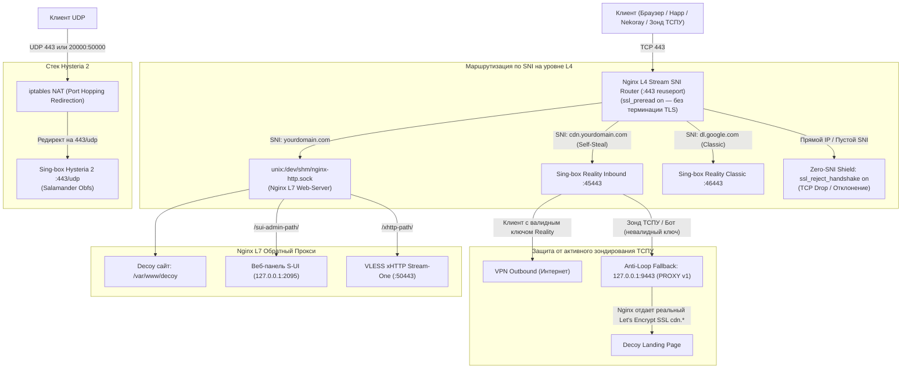

# S-UI Anti-DPI RU Reality Stack

<div align="center">

### Комплексный стек обхода блокировок ТСПУ (РКН) на базе панели S-UI и ядра Sing-box
**Nginx L4 Stream SNI Router • Self-Steal REALITY • Anti-Loop Fallback 9443 • Hysteria 2 Port Hopping • Cloudflare WARP Outbound**

[](https://github.com)
[](https://github.com)
[](https://github.com)
[](LICENSE)

</div>

---

## 📌 О проекте

**S-UI Anti-DPI RU Reality Stack** — это автоматизированный скрипт и архитектурный комплекс для развертывания персонального VPN-сервера на базе панели **S-UI (sing-box)**, спроектированный с учетом специфики блокировок российского ТСПУ (активное зондирование, блокировки протоколов, троттлинг UDP, сигнатурный анализ).

### 🛡️ Ключевые архитектурные преимущества

1. **Self-Steal REALITY (Кража собственного субдомена):**
   * Вместо классической кражи чужих SNI (Google, Apple), которая детектируется ТСПУ по несоответствию **IP $\leftrightarrow$ ASN**, используется собственный субдомен (`cdn.yourdomain.com`).
2. **Nginx L4 Stream SNI Router (Мультиплексирование порта 443):**
   * Nginx слушает TCP-порт 443 и маршрутизирует входящие соединения **без расшифровки TLS** по полю SNI (`ssl_preread on`).
3. **Anti-Loop Fallback (Порт 9443):**
   * При проверке активным сканером ТСПУ сервер не сбрасывает соединение, а перенаправляет хендшейк на локальный порт `9443` Nginx, где отдается **настоящий сертификат Let's Encrypt** и полноценный сайт-маскировка.
4. **Hysteria 2 с Port Hopping (Диапазон 20000–50000/udp):**
   * Обход троттлинга UDP на мобильных операторах РФ благодаря Salamander-обфускации и перенаправлению диапазона портов через `iptables NAT`.
5. **Поддержка UDP (Discord, Telegram, YouTube):**
   * Голосовые каналы Discord (WebRTC) и звонки Telegram инкапсулируются внутри TLS TCP-потока VLESS, благодаря чему не попадают под UDP-блокировки провайдеров.
6. **Smart Outbound Routing (Раздельная маршрутизация):**
   * Ресурсы РФ (Госуслуги, Сбербанк, Т-Банк, Кинопоиск, `.ru`) идут напрямую без капч и задержек.
   * Запросы к AI (OpenAI / ChatGPT, Claude, Gemini) направляются через Cloudflare WARP Outbound.
   * Торрент-трафик (BitTorrent) блокируется для защиты VPS от абуз и жалоб хостинга.
7. **Zero-SNI Shield:**
   * Прямые сканирования по IP (`https://IP`) и запросы с неизвестными SNI мгновенно сбрасываются директивой `ssl_reject_handshake on`.

---

## 🗺️ Схема маршрутизации трафика (Traffic Flow)



---

## 🚀 Быстрый старт (Установка за 1 команду)

Подключитесь к вашему VPS (Ubuntu или Debian) по SSH под пользователем `root` и выполните:

```bash
git clone https://github.com/essoke/s-ui-total.git /etc/s-ui-total && bash /etc/s-ui-total/install.sh
```

### Системные требования:
* **ОС:** Ubuntu 20.04 / 22.04 / 24.04 LTS или Debian 11 / 12 / 13.
* **Права:** `root` (или sudo).
* **Архитектура:** `x86_64 (amd64)` или `arm64 (aarch64)`.
* **Ресурсы:** Минимум 1 vCPU, 1 GB RAM (рекомендуется 2 GB RAM).

---

## 🎛️ Интерактивный установщик

Во время работы скрипт предложит гибкую настройку компонентов:
- **Наличие домена:**
  - При наличии домена настраивается `Self-Steal Reality` на субдомене `cdn.domain.com` с авто-выпуском Let's Encrypt.
  - Без домена настраивается режим работы по IP с самоподписанным сертификатом и маскировкой под внешние проверенные сервисы (Google/Apple).
- **Сетевая оптимизация ядра:**
  - Включение алгоритма контроля перегрузок `TCP BBR` и планировщика `FQ`.
  - Расширение сетевых буферов ядра Linux (`net.core.rmem_max` и `wmem_max` до 32 МБ) для стабильной работы Hysteria 2 и звонков в Discord/Telegram.
  - Увеличение системных лимитов дескрипторов файлов (`nofile` до 1 048 576).
- **Сетевая безопасность:**
  - Настройка фаервола `UFW` (разрешены только SSH, 80/tcp, 443/tcp, 443/udp и диапазон 20000:50000/udp).
  - Настройка `iptables NAT` для Port Hopping Hysteria 2.
  - Включение `Fail2ban` с агрессивным джейлом для SSH.
- **Разблокировка AI (Cloudflare WARP):**
  - Подключение изолированного WireGuard-аутбаунда в Sing-box для прозрачного доступа к ChatGPT, Claude и Gemini.

---

## 📱 Клиентские приложения

Все сгенерированные конфигурации полностью совместимы с современными клиентами:

| Платформа | Рекомендуемые клиенты | Поддерживаемые протоколы |
| :--- | :--- | :--- |
| **iOS** | **Happ**, **Karing**, **Sing-box** | VLESS Reality, Hysteria 2 |
| **Android** | **Happ**, **v2rayNG**, **Nekoray**, **Hiddify** | VLESS Reality, Hysteria 2, xHTTP |
| **Windows** | **Happ**, **Nekoray**, **v2rayN**, **Karing** | VLESS Reality, Hysteria 2, xHTTP |
| **macOS** | **Happ**, **Karing**, **V2Box** | VLESS Reality, Hysteria 2 |

---

## 🛠️ Консольная утилита управления `sui`

После установки на сервере становится доступна глобальная команда `sui`:

```bash
sui
```

### Возможности меню:
1. **Проверка статуса служб:** Мониторинг состояния Nginx, S-UI, Sing-box, UFW, Fail2ban и BBR.
2. **Вывод ссылок и QR-кодов:** Быстрый просмотр URI ссылок `vless://`, `hysteria2://`, QR-кодов в терминале и адреса веб-панели.
3. **Смена маскировочного SNI:** Быстрая замена маскировочного домена для Classic Reality на случай блокировок.
4. **Перезапуск сервисов:** Горячий рестарт Nginx и Sing-box/S-UI без перезагрузки всей системы.
5. **Обновление баз гео-маршрутизации:** Загрузка свежих баз `GeoIP` и `GeoSite` (Loyalsoldier) для точного разделения трафика РФ.
6. **Просмотр логов:** Журнал соединений Sing-box и логов Nginx в реальном времени.
7. **Полная деинсталляция:** Чистое удаление всех компонентов и сброс настроек сети.

---

## 📂 Структура репозитория

```text
S-UI-Total/
├── install.sh                  # Главный входной интерактивный установщик
├── bin/
│   └── sui                     # CLI утилита управления (/usr/local/bin/sui)
├── modules/
│   ├── preflight.sh            # Проверка ОС (Ubuntu/Debian), root, CPU, пакетов
│   ├── system_tuning.sh        # Настройка BBR, FQ, буферов TCP/UDP и ulimit
│   ├── firewall.sh             # Настройка UFW, iptables NAT (Port Hopping), Fail2ban
│   ├── ssl.sh                  # Получение Let's Encrypt и самоподписанных сертификатов
│   ├── nginx.sh                # Nginx L4 Stream SNI Router + Decoy + Anti-Loop 9443
│   ├── warp.sh                 # Cloudflare WARP Outbound (WireGuard профиль)
│   └── sui_panel.sh            # Установка S-UI + Sing-box, генерация ключей и конфигов
├── templates/
│   ├── singbox_server.json     # Серверная конфигурация Sing-box (Reality + Hy2 + WARP)
│   ├── client_template.json    # Клиентский профиль с умным обходом ресурсов РФ (Direct RU)
│   └── decoy_site/             # Профессиональный HTML5 сайт-маскировка
│       └── index.html
└── README.md                   # Документация проекта
```

---

## 📄 Лицензия

Проект распространяется под открытой лицензией [MIT](LICENSE).
